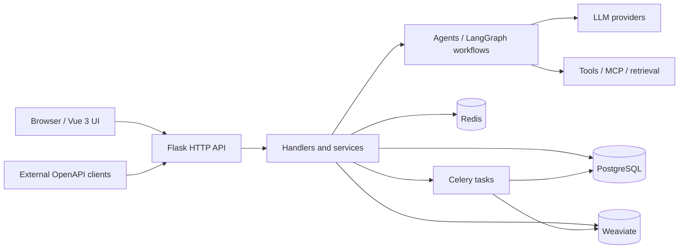

# OpenAgent architecture

This guide maps the **current repository structure**, not an assertion about a specific production deployment. The [Chinese version](architecture.zh-CN.md) uses the same component map.

## Component overview



The diagram groups modules by responsibility. It does **not** imply that every request uses every dependency or that every tool must call an external service.

## Source map

| Layer | Repository location | Responsibility |
| --- | --- | --- |
| Browser workspace | [`ui/src/views`](../ui/src/views), [`ui/src/router`](../ui/src/router) | Application, workflow, dataset, and public-store screens and routing |
| UI requests | [`ui/src/services`](../ui/src/services) | Browser-side API clients |
| API entry point | [`api/app/http/app.py`](../api/app/http/app.py), [`api/internal/router`](../api/internal/router) | Flask application and route registration |
| HTTP handlers | [`api/internal/handler`](../api/internal/handler) | Request parsing and response handling |
| Business services | [`api/internal/service`](../api/internal/service) | Apps, workflows, publishing, datasets, search, skills, and external integrations |
| Agent / workflow runtime | [`api/internal/core/agent`](../api/internal/core/agent), [`api/internal/core/workflow`](../api/internal/core/workflow) | Agent execution and LangGraph workflow construction |
| Retrieval and tools | [`api/internal/core/retrievers`](../api/internal/core/retrievers), [`api/internal/core/tools`](../api/internal/core/tools) | Search, tool invocation, and MCP catalog integration |
| Data models | [`api/internal/model`](../api/internal/model) | SQLAlchemy model definitions |
| Workers | [`api/internal/task`](../api/internal/task), [`api/internal/extension/celery_extension.py`](../api/internal/extension/celery_extension.py) | Asynchronous tasks |
| Infrastructure | [`docker/docker-compose.yaml`](../docker/docker-compose.yaml) | Containerized PostgreSQL, Redis, Weaviate, and optional application services |

## Representative request paths

1. **App management:** a browser view calls `ui/src/services`; a Flask route dispatches to a handler and a business service; the service accesses model and storage layers.
2. **Workflow execution:** workflow services use the implementation under `api/internal/core/workflow`, which constructs and compiles a LangGraph graph. A node may use language models, tools, or retrieval.
3. **Background work:** services can enqueue tasks implemented under `api/internal/task`; task processing is distinct from the HTTP request path.
4. **Public delivery:** published apps expose API and streaming interfaces, handled in the HTTP and service layers.

## Local development versus container deployment

To run Flask and Vite on the host, start **only the three supporting services** (from the repository root):

```bash
cd docker
docker compose up -d --no-build llmops-db llmops-redis llmops-weaviate
docker compose ps llmops-db llmops-redis llmops-weaviate
```

Use the published localhost ports in the host's `api/.env`. This command does not build or start the UI, API, Celery, or Nginx containers. Full-stack deployment has different settings and service dependencies; see [Docker configuration](../docker/README.md).

Do not commit real `.env` credentials. For troubleshooting, prefer focused module tests over running or rebuilding the complete application stack.
