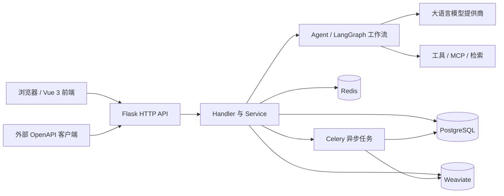

# OpenAgent 架构说明

本文对应**当前仓库的源码结构**，不代表某个线上环境的实际部署拓扑。与 [English version](architecture.md) 保持相同的组件关系。

## 组件概览



图中按职责分组；**不表示每次请求必然访问全部依赖**，也不表示每个工具都会调用外部服务。

## 源码目录与职责

| 层级 | 仓库位置 | 职责 |
| --- | --- | --- |
| 前端工作台 | [`ui/src/views`](../ui/src/views)、[`ui/src/router`](../ui/src/router) | 应用、工作流、数据集、广场等页面及路由 |
| 前端 API 调用 | [`ui/src/services`](../ui/src/services) | 浏览器侧请求封装 |
| API 入口 | [`api/app/http/app.py`](../api/app/http/app.py)、[`api/internal/router`](../api/internal/router) | Flask 应用与路由注册 |
| HTTP 处理层 | [`api/internal/handler`](../api/internal/handler) | 请求参数处理和响应 |
| 业务服务层 | [`api/internal/service`](../api/internal/service) | 应用、工作流、发布、知识库、Skills 等业务 |
| Agent 与工作流运行时 | [`api/internal/core/agent`](../api/internal/core/agent)、[`api/internal/core/workflow`](../api/internal/core/workflow) | Agent 执行与 LangGraph 图编译 |
| 检索与工具 | [`api/internal/core/retrievers`](../api/internal/core/retrievers)、[`api/internal/core/tools`](../api/internal/core/tools) | 检索、工具调用和 MCP 目录接入 |
| 数据模型 | [`api/internal/model`](../api/internal/model) | SQLAlchemy 模型定义 |
| 后台任务 | [`api/internal/task`](../api/internal/task)、[`api/internal/extension/celery_extension.py`](../api/internal/extension/celery_extension.py) | 异步任务 |
| 基础设施 | [`docker/docker-compose.yaml`](../docker/docker-compose.yaml) | PostgreSQL、Redis、Weaviate 及可选应用容器 |

## 典型请求链路

1. **应用管理：** 前端页面调用 `ui/src/services`；Flask 路由转发给 Handler 和 Service；Service 读写模型与存储层。
2. **工作流执行：** 工作流服务调用 `api/internal/core/workflow` 中的构建器，编译 LangGraph 图，节点可使用模型、工具与检索。
3. **后台任务：** Service 可以提交 `api/internal/task` 中的异步任务，任务处理与 HTTP 请求分离。
4. **公开交付：** 发布后的应用通过 HTTP、流式接口暴露能力，由对应 Handler 和 Service 处理。

## 本地开发和容器化部署

本地运行 Flask 与 Vite 时，只启动**三个基础设施服务**（从仓库根目录进入）：

```bash
cd docker
docker compose up -d --no-build llmops-db llmops-redis llmops-weaviate
docker compose ps llmops-db llmops-redis llmops-weaviate
```

宿主机的 `api/.env` 应使用映射的 localhost 端口。上述命令不会构建或启动 UI、API、Celery、Nginx 容器。完整容器化部署依赖不同的服务配置，参见 [Docker 配置说明](../docker/README.md)。

不要提交真实的 `.env` 密钥。排查问题时优先运行针对性测试，而非重建整个应用栈。
